# Diary App — Praktikum Pertemuan 6: State dan Hooks pada React Native

| | |
|---|---|
| **Nama** | Abyan Alfairus |
| **NIM** | 2430511014 |
| **Kelas** | A |
| **Mata Kuliah** | Mobile Programming |
| **Program Studi** | Teknik Informatika, Fakultas Sains dan Teknologi, Universitas Muhammadiyah Sukabumi |
| **Platform** | React Native + Expo CLI (Expo SDK 58, Expo Router) |
| **Project** | `diary-app6` |

Diary App multi-screen yang dibangun dari nol untuk mempelajari `useState`, `useContext`, `useEffect`, `useMemo`, `useCallback`, `useRef`, dan custom hook. Fiturnya meliputi pencarian dengan debounce, filter mood, Like, tab Favorit, tambah diary, detail, dan pengaturan.

---

## 1. Cara Menjalankan Project

**Prasyarat:** Node.js + npm, Visual Studio Code, dan Expo Go (HP) atau Android Emulator.

```bash
# 1. Masuk ke folder project
cd diary-app6

# 2. Install dependency (node_modules tidak ikut dikumpulkan)
npm install

# 3. Jalankan (flag -c membersihkan cache Metro)
npx expo start -c
```

- Tekan **a** untuk membuka di Android Emulator.
- **Scan QR code** dengan aplikasi Expo Go untuk menjalankan di HP.
- Tekan **w** untuk membuka versi web (opsional).
- Tekan **Ctrl + C** untuk menghentikan server.

Cek tipe (opsional): `npx tsc --noEmit`

> Catatan: `app.json` memakai `"web": { "output": "single" }` supaya versi web langsung berjalan sebagai SPA. Pengaturan ini tidak memengaruhi Android/iOS.

---

## 2. Struktur Project

```
diary-app6/
├── app/
│   ├── _layout.tsx            # Root Stack + DiaryProvider
│   ├── +html.tsx              # Template HTML (web)
│   ├── +not-found.tsx         # Halaman 404
│   ├── (tabs)/
│   │   ├── _layout.tsx        # Bottom Tabs + badge jumlah favorit
│   │   ├── index.tsx          # Home: search, filter mood, reset, daftar diary
│   │   ├── favorites.tsx      # [TUGAS] Tab Favorit
│   │   ├── create.tsx         # Tambah diary (controlled input)
│   │   └── settings.tsx       # Pengaturan (local state)
│   └── detail/
│       └── [id].tsx           # Detail diary + Like
├── src/
│   ├── components/
│   │   ├── DiaryCard.tsx      # Kartu diary (React.memo)
│   │   └── EmptyState.tsx     # Tampilan saat list kosong
│   ├── constants/
│   │   └── moods.ts           # Daftar mood (dipakai Create & filter Home)
│   ├── context/
│   │   └── DiaryContext.tsx   # Shared state: entries, likedIds, addEntry, toggleLike
│   ├── hooks/
│   │   ├── useDiarySearch.ts  # Custom hook: query + debounce + filter mood
│   │   └── useLikedEntries.ts # [TUGAS] Custom hook diary yang disukai
│   └── styles/
│       └── tokens.ts          # Design tokens: warna, spacing, radius, tipografi, shadow
└── docs/screenshots/          # Screenshot hasil aplikasi
```

---

## 3. Penyelesaian Tugas Praktikum (Bagian V)

| No | Tugas | Implementasi |
|---|---|---|
| 1 | Filter Mood di Home memakai `useState` | State `selectedMood` (`useState<string \| null>`) di `useDiarySearch`. Di Home tampil sebagai chip mood. Tap chip yang sama sekali lagi akan mematikan filter. |
| 2 | Gabungkan query + filter mood dengan `useMemo` | `filteredEntries` di `useDiarySearch` memakai `useMemo` dengan dependency `[entries, debouncedQuery, selectedMood]`. Satu entri harus lolos **kedua** syarat (mood **dan** kata kunci). |
| 3 | Custom hook `useLikedEntries(entries, likedIds)` | `src/hooks/useLikedEntries.ts` mengembalikan `likedEntries` dan `likedCount`, dihitung dengan `useMemo`. |
| 4 | Tab Favorites | `app/(tabs)/favorites.tsx` hanya menampilkan diary yang disukai. Ikon tab menampilkan badge jumlah favorit. |
| 5 | Like sinkron Home ↔ Detail ↔ Favorites | Ketiga screen membaca `likedIds` dan memanggil `toggleLike` dari **Context yang sama**, jadi tidak ada salinan state yang bisa berbeda. Unlike di Favorit langsung menghapus kartu dan ♥ di Home ikut berubah. |
| 6 | Tombol Reset Filter | `resetFilters()` mengosongkan `query`, `debouncedQuery`, dan `selectedMood` sekaligus. Tombol nonaktif (redup) jika tidak ada filter aktif. |
| 7 | Penjelasan minimal 5 Hooks | Lihat **Bagian 4** di bawah. |
| 8 | Perbaikan Styles | Lihat **Bagian 6** di bawah. |

---

## 4. Tabel Penjelasan Hooks

| Hook | Lokasi | Input | Output | Dependency | Alasan Pemilihan |
|---|---|---|---|---|---|
| `useState` | `DiaryProvider` | Nilai awal `INITIAL_ENTRIES` dan `new Set()` | `[entries, setEntries]`, `[likedIds, setLikedIds]` | – | Shared state tetap butuh sumber state React. Setiap `setEntries`/`setLikedIds` memicu render ulang semua consumer. Update dibuat **immutable** (array baru, `new Set(prev)`). |
| `useState` | `CreateScreen` | `''`, `'2026-11-02'`, `''`, mood default | `title`, `date`, `body`, `mood` + setter | – | Data form hanya dibutuhkan di screen ini, jadi cukup local state. Setiap `TextInput` adalah *controlled input*. `canSave` diturunkan langsung dari state (tidak perlu state tambahan). |
| `useState` | `useDiarySearch` | `''`, `''`, `null` | `query`, `debouncedQuery`, `selectedMood` | – | `query` mengikuti ketikan secara langsung, `debouncedQuery` adalah nilai yang benar-benar dipakai untuk filter, dan `selectedMood` adalah filter mood. |
| `useContext` | `useDiary()` | `DiaryContext` | `{ entries, likedIds, addEntry, toggleLike, getById }` | – | Home, Favorit, Create, Detail, dan Tabs layout butuh data yang sama. Context mencegah *prop drilling* dan menjamin satu sumber data, sehingga Like selalu sinkron. Melempar error jika dipakai di luar Provider. |
| `useEffect` | `useDiarySearch` | Callback yang membuat `setTimeout` 350 ms | Cleanup `clearTimeout(timer)` | `[query]` | Timer adalah side effect di luar React. Setiap `query` berubah, timer lama dibatalkan oleh cleanup sehingga filter hanya berjalan setelah user berhenti mengetik (debounce). |
| `useMemo` | `useDiarySearch` | `entries`, `debouncedQuery`, `selectedMood` | `filteredEntries` | `[entries, debouncedQuery, selectedMood]` | *Derived data*: hasil filter dihitung ulang hanya jika salah satu dependency berubah, tidak di setiap render (misalnya saat `query` berubah sebelum debounce selesai). |
| `useMemo` | `useLikedEntries` | `entries`, `likedIds` | `likedEntries` | `[entries, likedIds]` | Daftar favorit adalah turunan dari dua state, jadi cukup dihitung, tidak disimpan sebagai state baru yang bisa tidak sinkron. |
| `useMemo` | `DiaryProvider` | Semua nilai context | Object `value` | `[entries, likedIds, addEntry, toggleLike, getById]` | Object `value` hanya dibuat ulang jika isinya berubah, sehingga consumer tidak re-render tanpa alasan. |
| `useCallback` | `HomeScreen` | Fungsi `openDetail`, `clearSearch`, `handleReset` | Referensi fungsi stabil | `[router]`, `[setQuery]`, `[resetFilters]` | `openDetail` dikirim ke `DiaryCard` yang dibungkus `React.memo`. Karena referensinya stabil, kartu yang tidak berubah tidak ikut re-render. |
| `useCallback` | `DiaryProvider` | `addEntry`, `toggleLike`, `getById` | Referensi fungsi stabil | `[]`, `[]`, `[entries]` | Supaya dependency `useMemo` pada `value` akurat, dan `toggleLike` bisa langsung dikirim ke `DiaryCard` sebagai prop yang stabil. |
| `useRef` | `HomeScreen` | `null` | `searchRef` (ref ke `TextInput`) | – | Dipakai untuk `focus()` setelah Clear dan `blur()` setelah Reset. Mengubah ref **tidak** memicu render ulang, berbeda dengan state. |
| Custom Hook | `useDiarySearch` | `entries` | `query`, `setQuery`, `selectedMood`, `toggleMood`, `resetFilters`, `hasActiveFilter`, `filteredEntries`, `resultCount` | – | Mengemas logic pencarian + filter (state, effect, memo) agar HomeScreen hanya fokus ke UI dan logic-nya bisa dipakai ulang. |
| Custom Hook | `useLikedEntries` | `entries`, `likedIds` | `likedEntries`, `likedCount` | – | Logic "ambil diary yang disukai" dipisah dari screen Favorit sehingga reusable dan mudah diuji. |

### Penyesuaian kecil dari kode modul

1. **`DiaryCard` menerima `id` dan callback `(id) => void`.** Di modul, `renderItem` membuat arrow function baru (`() => openDetail(item.id)`) di setiap render, jadi `useCallback` pada `openDetail` tidak berpengaruh ke kartu. Sekarang `openDetail` dan `toggleLike` dikirim langsung, dan `DiaryCard` dibungkus `React.memo`. Hasilnya, `useCallback` benar-benar mencegah re-render kartu yang tidak berubah.
2. **Fungsi di `DiaryProvider` dibungkus `useCallback`** dan dimasukkan ke dependency `useMemo` agar dependency array lengkap dan akurat.
3. **`resetFilters` juga mengosongkan `debouncedQuery`** agar hasil kembali penuh seketika tanpa menunggu 350 ms.

---

## 5. Alur State

**Search + Filter Mood**
```
User mengetik → setQuery() → render → useEffect membuat timer 350 ms
→ (cleanup membatalkan timer lama jika masih mengetik) → setDebouncedQuery()
→ useMemo(entries, debouncedQuery, selectedMood) → FlatList menampilkan hasil
```

**Like (Home / Detail / Favorit)**
```
User tekan ♡ → onToggleLike(id) → toggleLike(id) di Context
→ setLikedIds(prev => new Set(prev) ...) → Context berubah
→ Home, Detail, Favorit, dan badge tab membaca state terbaru → ♡ menjadi ♥
```

**Tambah Diary**
```
Input form (useState per input) → Simpan → addEntry()
→ setEntries(prev => [newEntry, ...prev]) → Home menampilkan diary baru
```

---

## 6. Perbaikan Styles

- **Design tokens diperluas** (`tokens.ts`): warna `subtle`, `accentSoft`, `dangerSoft`, spacing `xs`/`xxl`, radius `input`/`pill`, tipografi `h2`, dan `SHADOW` lintas platform (iOS `shadow*`, Android `elevation`, web `boxShadow`).
- **Header setiap screen** memakai *eyebrow* kecil berwarna + judul tebal, dan dibungkus `SafeAreaView` supaya tidak tertutup notch/status bar.
- **Search bar** dengan ikon 🔍, tombol Clear berbentuk pill yang hanya muncul saat ada teks.
- **Chip filter mood** dengan emoji + label. Chip aktif diberi border dan latar biru.
- **DiaryCard**: badge mood berlatar, judul tebal, tanggal abu-abu, preview 2 baris, tombol Like bulat (merah muda saat disukai), dan efek tekan (opacity).
- **Empty state** dengan ikon dan pesan bantuan (Home & Favorit).
- **Form Tambah** dikelompokkan dalam kartu, ada label di setiap input, penghitung karakter, pilihan mood berbentuk tile dengan label, serta pesan bantuan saat tombol Simpan nonaktif. Form juga memakai `KeyboardAvoidingView` + `ScrollView`.
- **Detail**: emoji besar + pill nama mood, isi di dalam kartu dengan pemisah, dan tombol Like yang berubah menjadi merah penuh saat disukai.
- **Tab bar** memakai ikon (`expo-symbols`), warna aktif biru, dan badge jumlah favorit.
- **Settings**: baris pengaturan di dalam kartu dengan deskripsi, switch berwarna aksen, dan pill status state.

---

## 7. Eksperimen Re-render (Bagian S)

Dengan `console.log('HomeScreen render')` di HomeScreen:

| Aksi | HomeScreen render? | State pemicu |
|---|---|---|
| Ketik 1 karakter di Search | Ya, **2 kali**: langsung, lalu sekali lagi ±350 ms kemudian | `query` (langsung), lalu `debouncedQuery` (setelah timer debounce) |
| Tekan Like | Ya | `likedIds` di Context berubah, sehingga `value` Context baru dan semua consumer `useDiary()` render ulang |
| Tekan Clear | Ya | `query` menjadi `''` lalu `debouncedQuery` menjadi `''`. `searchRef.focus()` sendiri **tidak** memicu render karena `useRef` |
| Pindah tab lalu kembali | Umumnya **tidak**, karena screen tab tetap ter-mount. Home baru render ulang jika ada state Context yang berubah selama di tab lain (misalnya Like dari Favorit atau tambah diary) | – |

Kesimpulan: komponen render ulang hanya jika state/context yang dibacanya berubah. `useRef` tidak memicu render. `console.log` sudah dihapus setelah eksperimen.

---

## 8. Checklist Hasil Praktikum

- [x] Project `diary-app6` dibuat dengan Expo CLI (`npx create-expo-app@latest diary-app6 --template tabs`)
- [x] Expo Router berjalan (Stack + Tabs + route dinamis `detail/[id]`)
- [x] `DiaryProvider` terpasang di root
- [x] Home menampilkan daftar diary
- [x] Search memakai custom hook
- [x] `useEffect` debounce memiliki cleanup
- [x] `useMemo` menghitung `filteredEntries`
- [x] `useRef` mengembalikan fokus ke search
- [x] `useCallback` dipakai pada callback Home
- [x] Create memakai controlled state
- [x] Like konsisten Home ↔ Detail ↔ Favorit
- [x] Diary baru muncul setelah disimpan
- [x] Settings menunjukkan perubahan state
- [x] **Tugas:** filter mood, `useLikedEntries`, tab Favorit, Reset Filter, penjelasan Hooks, perbaikan style

---

## 9. Screenshot

| Home | Search | Filter Mood |
|---|---|---|
| 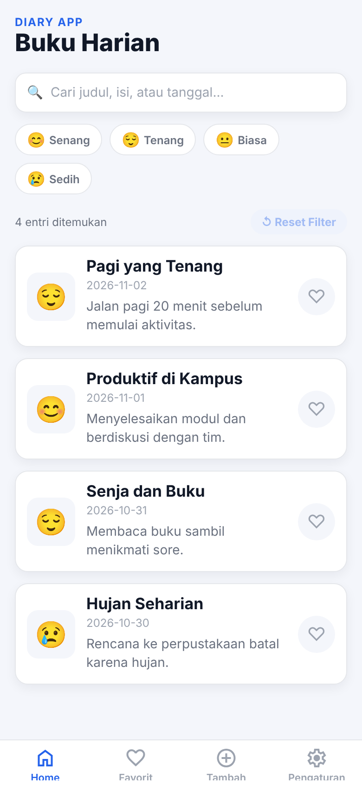 | 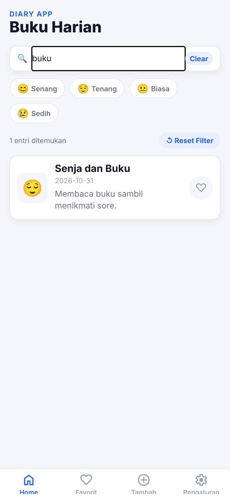 | 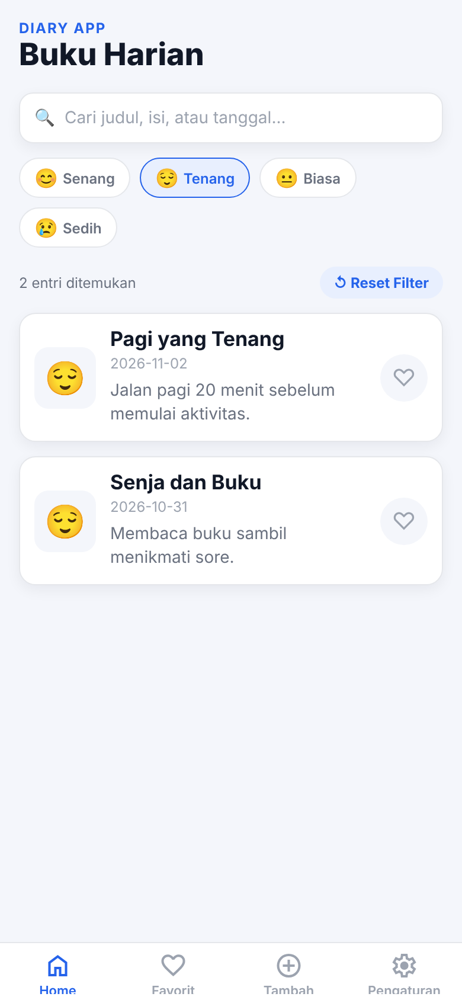 |

| Like di Home | Detail | Favorit |
|---|---|---|
| 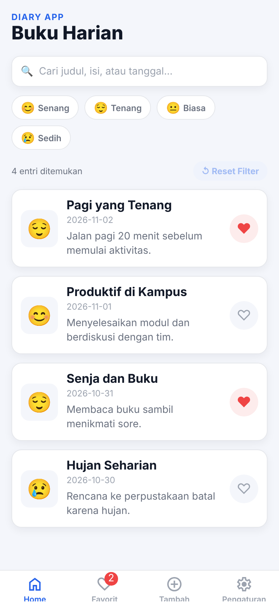 | 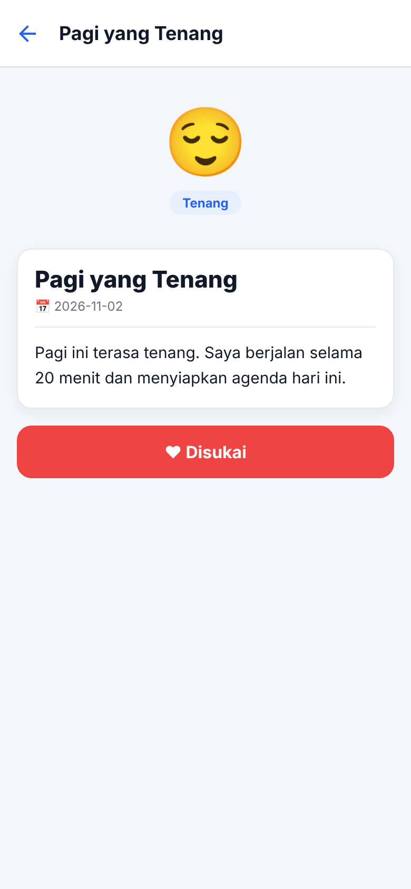 | 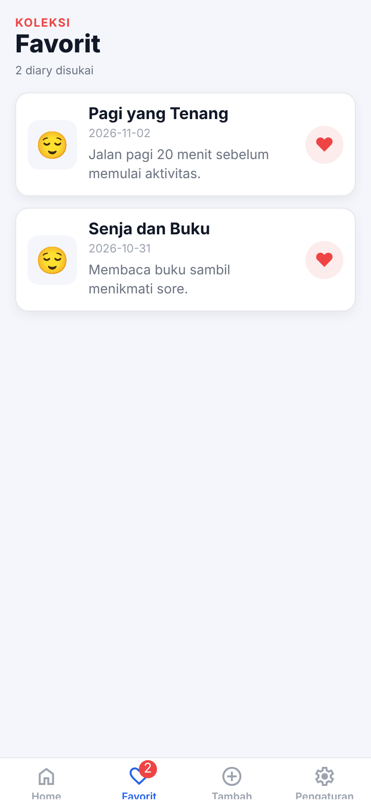 |

| Sinkron setelah Unlike di Favorit | Tambah (kosong) | Tambah (terisi) |
|---|---|---|
| 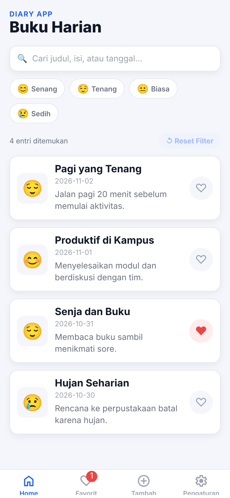 | 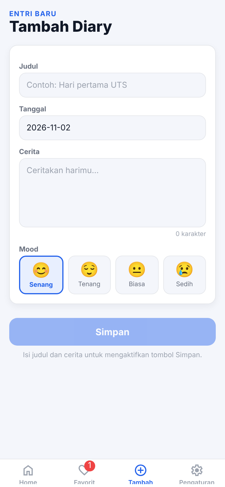 | 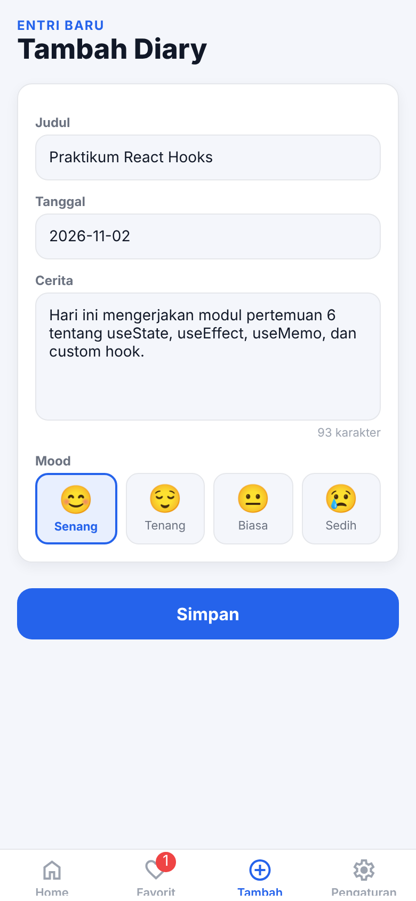 |

| Home setelah Simpan | Pengaturan |
|---|---|
| 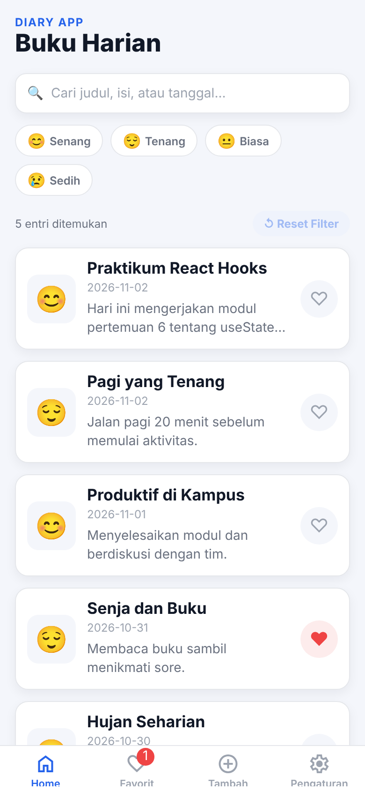 | 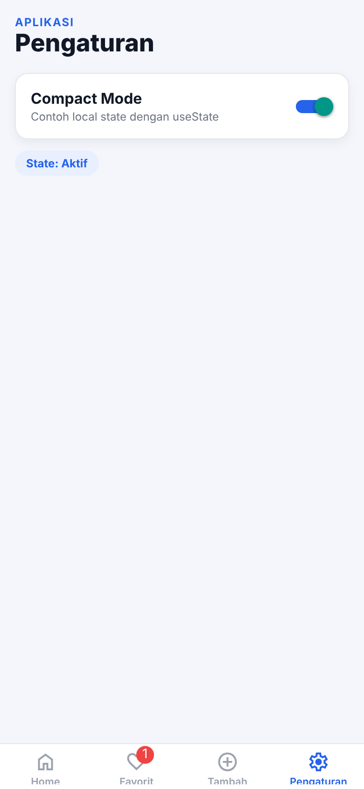 |

> Screenshot diambil dari versi web (`npx expo start --web`) dengan ukuran layar ponsel 390×844. Untuk pengumpulan, sebaiknya ambil ulang screenshot dari Expo Go/Emulator.
